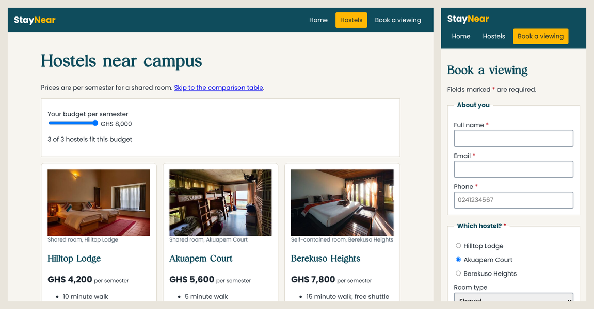

# StayNear: A Campus Hostel Finder

StayNear is a small, responsive website that helps students compare hostels near campus and book a viewing **before** paying for a room they have never seen.

It was built as the Lessons 1–7 synthesis project for a Web Technologies course, using only HTML, CSS and plain JavaScript: no frameworks, no build step and no server-side code.

> The three hostels, their prices and their contact details are fictional.



## Features

- **Compare hostels** on cards with photos, prices and key facilities.
- **Filter by budget** with a slider that hides hostels you cannot afford.
- **Side-by-side table** of prices, walking time and Wi-Fi for every hostel.
- **Book a viewing** from any card; the form opens with that hostel already selected.
- **Live cost estimate** that updates as you choose a room type, extras and semesters.
- **Validation without JavaScript**, using HTML attributes such as `required`, `pattern` and `min`/`max`.
- **Review dialog** that lists everything the form is about to send.
- **Confirmation page** that reads the submitted data back from the URL.
- **Works on phones and laptops** from the same code (mobile-first layout).

## Pages

| Page | What it does |
|---|---|
| `index.html` | Home page: what StayNear does, how it works, a viewing checklist and a glossary of hostel terms |
| `hostels.html` | Hostel cards, the budget filter and the comparison table |
| `book.html` | The viewing request form and the review dialog |
| `confirmation.html` | Shows exactly what the form sent |

## Run it locally

1. Clone the repository:
   ```bash
   git clone https://github.com/dan-the-man7/StayNear_Synthesis_Project_Web_Tech.git
   ```
2. Open the folder in VS Code.
3. Start a local server, for example by right-clicking `index.html` and choosing **Open with Live Server**.

Use a local server rather than double-clicking the file. The booking form sends a real GET request to `confirmation.html`, and you can only watch that request (and the query string in the address bar) when the site is served over `http://`.

## How it works

1. A **Book a viewing** link on a card carries the hostel in its query string, for example `book.html?hostel=akuapem`.
2. `script.js` reads that value with `URLSearchParams` and ticks the matching radio button.
3. As the visitor fills in the form, `FormData` collects the same name/value pairs the form will send and updates the cost estimate.
4. **Review** runs the browser's built-in validation and, if everything passes, opens a `<dialog>` listing each pair.
5. **Send request** submits the form with `method="GET"`, so every pair is added to the URL of `confirmation.html`.
6. The confirmation page reads those pairs back and builds one table row for each.

Nothing is stored. Refreshing the confirmation page shows the same data because it is all in the URL.

## Concepts used, by lesson

| Lesson | Topic | Where it appears |
|---|---|---|
| 1 | Client, server, requests and URLs | Local server; the GET request read back on the confirmation page |
| 2 | HTML syntax, headings and metadata | Every page's `<head>`: `charset`, `viewport`, `title`, `description`, favicon |
| 3 | Emphasis, lists and document structure | `<em>`/`<strong>`, ordered, unordered and description lists, `<header>`, `<nav>`, `<main>`, `<section>`, `<article>`, `<aside>`, `<footer>` |
| 4 | Links, images and tables | Fragment, `mailto:`, `tel:` and query-string links; `<picture>`, `srcset`, `sizes`, `<figure>`; table with `<caption>`, `scope` and `colspan` |
| 5 | Forms and HTML APIs | Labels, fieldsets, radio groups, checkboxes, built-in validation, `<output>`, `<dialog>`, the DOM, `FormData`, `ValidityState` |
| 6 | CSS basics | One external stylesheet; type, class, descendant, attribute and state selectors; `@font-face`; `calc()` |
| 7 | Box model and responsive design | `box-sizing: border-box`, `inline-block` navigation, `max-width`, viewport meta tag, a mobile-first media query, responsive images |

## Project structure

```text
StayNear_Synthesis_Project_Web_Tech/
├── index.html
├── hostels.html
├── book.html
├── confirmation.html
├── styles.css
├── script.js
├── fonts/            Poppins and Editorial Today (.woff2)
├── images/
│   ├── favicon.svg
│   └── photos/       hero and hostel photos in two sizes each
└── docs/
    └── screenshot.png
```

## Credits

**Photos** (from [Unsplash](https://unsplash.com)):

- Student housing block by [Nick Kimel](https://unsplash.com/photos/GrLnSHJT1fI)
- Hilltop Lodge room by [Sreesanth P](https://unsplash.com/photos/NHVI1dkl6WU)
- Akuapem Court room by [Zoshua Colah](https://unsplash.com/photos/TzMGehZmocI)
- Berekuso Heights room by [Sasha Kaunas](https://unsplash.com/photos/Fk9d0cxYqC4)

**Fonts:**

- [Poppins](https://fonts.google.com/specimen/Poppins) for body text and buttons (SIL Open Font License)
- Editorial Today for headings

## Author

Daniel Oko Tettey ([@dan-the-man7](https://github.com/dan-the-man7))

## License

The code is released under the [MIT License](LICENSE). The photos and fonts keep their own licences.
